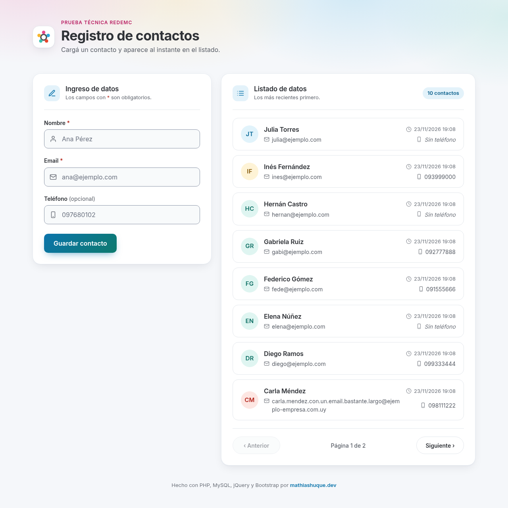

# redemc-prueba-desarrollo

Prueba técnica para el puesto de desarrollador web en RedEMC: formulario de alta de contactos (nombre, email y teléfono opcional) con validación y guardado por AJAX en MySQL, y listado dinámico de los registros. La especificación técnica está en [`task.md`](task.md).

**Aplicación desplegada: https://app-production-51090269.up.railway.app**

**Stack**: HTML5, CSS3, Bootstrap 5, JavaScript con jQuery, PHP 8.4 (sin framework) y MySQL 8.4. Desplegado en Railway.



## Funcionalidad

- **Formulario de alta**: nombre (obligatorio, solo letras y espacios, con tildes y `ñ`), email (obligatorio, único sin distinguir mayúsculas) y teléfono (opcional, 9 dígitos que empiezan con `09`, único). La validación corre en el navegador y se repite en el servidor, que es la autoridad. Los errores se muestran por campo sin borrar los demás datos.
- **Alta por AJAX**: el registro se guarda sin recargar la página. El nuevo contacto aparece primero en el listado.
- **Listado**: se carga desde MySQL al abrir la página, con la fecha de inserción y paginado de 8 registros por página.
- **Endpoints** (JSON, en `public/api/`):
  - `POST /api/crear.php`: formulario `application/x-www-form-urlencoded`. Responde `201` con el contacto creado, `422` con `errors` por campo si la validación falla, `409` si el email o el teléfono ya existen, `415` si el tipo de contenido no es de formulario y `405` si el método no es `POST`.
  - `GET /api/listar.php?page=N`: responde `200` con `data`, `page`, `perPage`, `total` y `totalPages`, y `405` si el método no es `GET`.
  - `GET /api/health.php`: `200` con `{"status":"ok","db":true}` si la base responde, y `503` si no.

El proceso de desarrollo con IA está documentado en [`PROCESO_IA.md`](PROCESO_IA.md).

## Estructura

```text
public/              docroot (lo único que sirve Apache)
  index.php          pantalla principal
  api/               crear.php, listar.php y health.php
  css/  js/
src/                 lógica PHP (namespace App\)
database/schema.sql  estructura de la tabla
bin/migrate.php      aplica el esquema al arrancar
tests/               PHPUnit: Unit e Integration
docker/              configuración de Apache y entrypoint
docs/                planes de features y bitácora de uso de IA
scripts/             hooks locales (registro de prompts y commit-msg)
.github/workflows/   CI y CD
```

Los endpoints están en `public/api/` (y no en `api/` como sugiere la estructura orientativa) para que el docroot sea `public/` y el código de `src/`, la base y los tests nunca queden expuestos.

## Desarrollo local

Requisitos: Docker (con Compose), Node.js 20 o superior y `make`. PHP, Composer y MySQL corren en contenedores.

```bash
make setup   # dependencias de Composer y npm, y hooks de git
make up      # app en http://localhost:8080 y MySQL en localhost:3307
```

Si el puerto 8080 está ocupado: `APP_PORT=8081 make up`. Para cambiar otros valores locales, copiá `.env.example` a `.env`.

| Comando | Qué hace |
|---|---|
| `make check` | parallel-lint, PHPCS (PSR-12), PHPStan (nivel 6), PHPUnit Unit, ESLint y Stylelint |
| `make test-integration` | levanta el stack y corre los tests de integración contra la app |
| `make fix` | corrige el estilo PHP con phpcbf |
| `make logs` / `make down` | logs de la app / detener contenedores |

## Flujo de trabajo (gitflow)

- `main`: producción. Cada push despliega en Railway.
- `develop`: integración.
- `feature/<nombre>`: una rama por feature, creada desde `develop` y mergeada a `develop` por pull request.

Los commits no llevan atribución a herramientas de IA. El hook `commit-msg` (activado por `make setup`) lo verifica al commitear.

## CI/CD

- **CI** (`.github/workflows/ci.yml`) corre en todas las ramas y en los pull requests:
  - PHP: `composer validate`, lint de sintaxis, PHPCS, PHPStan y tests unitarios.
  - Frontend: ESLint y Stylelint.
  - Integración: MySQL en un contenedor de servicio, esquema aplicado y tests contra la app con `php -S`.
  - Construcción de la imagen Docker de producción y prueba de que respeta `$PORT`.
- **CD** (`.github/workflows/cd.yml`) corre el CI completo y, si pasa, despliega en Railway con `railway up`, y después prueba `/api/health.php` en la URL pública. Se ejecuta automáticamente en cada push a `main`, y a mano desde `main` o `develop` en *Actions → CD → Run workflow*. Ambos despliegan al mismo servicio de Railway.

## Deploy en Railway

La aplicación corre en un proyecto de Railway con dos servicios:

- **`app`**: la aplicación. Se construye con el `Dockerfile` de este repositorio (target `prod`, PHP 8.4 + Apache). El servicio no está conectado al repositorio: el único deploy es el del CD, que sube el código con `railway up` y Railway lo construye con ese Dockerfile. Railway inyecta la variable `PORT`. Al arrancar, el contenedor aplica `database/schema.sql` con `bin/migrate.php`, así que la tabla se crea sola.
- **`MySQL`**: la base de datos, en el mismo proyecto.

La app recibe la conexión por referencia al servicio MySQL, en las variables del servicio `app`:

```text
DB_HOST=${{MySQL.MYSQLHOST}}
DB_PORT=${{MySQL.MYSQLPORT}}
DB_NAME=${{MySQL.MYSQLDATABASE}}
DB_USER=${{MySQL.MYSQLUSER}}
DB_PASSWORD=${{MySQL.MYSQLPASSWORD}}
```

El dominio público se generó desde *Settings → Networking* del servicio `app`. El token de proyecto para el CD se creó en *Project Settings → Tokens*.

En GitHub, en *Settings → Secrets and variables → Actions*, se cargaron:

- Secret `RAILWAY_TOKEN`: el token de proyecto. Es un secreto y no está en el repositorio.
- Variable `RAILWAY_SERVICE`: `app`.
- Variable `APP_URL`: la URL pública, sin barra final. El workflow acepta con o sin `https://`.

**Cómo se despliega**: el workflow `.github/workflows/cd.yml` corre el CI completo y, si pasa, ejecuta `railway up` y prueba `/api/health.php` en la URL pública. Se dispara solo en cada push a `main`, y a mano desde *Actions → CD → Run workflow* en `main` o `develop`. Ambas ramas despliegan al mismo servicio.

**Comprobación**: `https://app-production-51090269.up.railway.app/api/health.php` responde `{"status":"ok","db":true}`.

## Seguridad

[`docs/SEGURIDAD.md`](docs/SEGURIDAD.md) tiene el análisis completo: inyección SQL, XSS, CSRF, cabeceras, dependencias y escaneo de la imagen con Trivy. Resume qué se corrigió y qué riesgos se aceptan. Puntos principales:

- Consultas preparadas reales con PDO, y datos pintados con `.text()`.
- CSP y SRI en los recursos de CDN.
- Protección CSRF por origen en el alta.
- Contenedor sin root, con imágenes de versión fija.
- El job `security` del CI corre `composer audit`, `npm audit` y Trivy, y Dependabot propone las actualizaciones.

## Desarrollo con IA

El repositorio incluye un harness para trabajar con agentes de IA:

- [`AGENTS.md`](AGENTS.md): guía del proyecto para cualquier agente (convenciones, seguridad, gitflow, definición de hecho). [`CLAUDE.md`](CLAUDE.md) la importa para Claude Code.
- Skills en `.agents/skills/` (expuestas en `.claude/skills/`): `planificar-feature`, `implementar-feature`, `verificar-cambio`, `desplegar-railway`, `registrar-prompts`, `registrar-proceso-ia` y `preparar-entrega`.
- Agente `revisor` (`.claude/agents/revisor.md`) para revisar cambios antes de un PR.
- Registro automático de cada prompt en [`docs/ia/prompts.md`](docs/ia/prompts.md) mediante un hook de Claude Code, y bitácora de decisiones en [`docs/ia/bitacora.md`](docs/ia/bitacora.md). Ambos alimentan [`PROCESO_IA.md`](PROCESO_IA.md), que resume las herramientas usadas, los prompts clave, una sugerencia corregida y lo aprendido.
